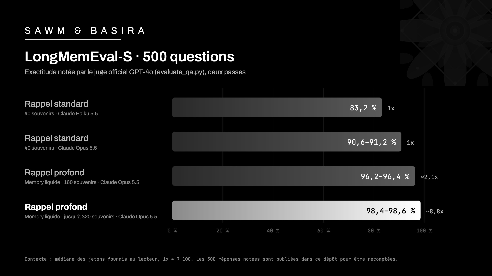

# SAWM & Basira Memory liquide — LongMemEval

**98,4 % – 98,6 %** sur LongMemEval-S (500 questions), notés par le juge officiel GPT-4o.
Chaque réponse est publiée ici, question par question, avec le verdict du juge : recomptez-les vous-même.

> **English summary.** SAWM & Basira Memory liquide (version 3, deep recall) scores **98.4 % – 98.6 %** on
> LongMemEval-S (500 questions), graded by the official GPT-4o judge (`evaluate_qa.py`, unchanged), over two
> independent judge passes. All 500 graded answers of every version are published per question, with an offline
> recount script. Version 3 deep recall is being rolled out on the Basira API.



## Ce que mesure LongMemEval

LongMemEval est le test académique de référence pour la mémoire à long terme des assistants et des agents IA.
Pour chacune des 500 questions, l'assistant a derrière lui l'historique d'une cinquantaine de conversations avec un
utilisateur, soit environ 115 000 jetons. Il doit alors :

- retrouver un détail donné il y a des semaines ;
- rassembler des informations dispersées dans plusieurs conversations ;
- raisonner sur les dates et l'ordre des événements ;
- suivre une information qui a changé ;
- reconnaître quand l'information n'a jamais été donnée.

## Résultats

| Version | Rappel de Basira | Lecteur | Juge, passe 1 | Juge, passe 2 | Contexte médian |
|---|---|---|---|---|---|
| **3** | **Rappel profond — Memory liquide (jusqu'à 320 souvenirs)** | **Claude Opus 5.5** | **98,4 % (492/500)** | **98,6 % (493/500)** | **≈ 62 600 jetons (~8,8x)** |
| 2 | Rappel profond — Memory liquide (160 souvenirs) | Claude Opus 5.5 | 96,2 % (481/500) | 96,4 % (482/500) | ≈ 14 800 jetons (~2,1x) |
| 1 | Rappel standard (40 souvenirs) | Claude Opus 5.5 | 90,6 % (453/500) | 91,2 % (456/500) | ≈ 7 100 jetons (1x) |
| 1 | Rappel standard (40 souvenirs) | Claude Haiku 5.5 | 83,2 % (416/500) | | ≈ 7 100 jetons (1x) |

Version 3, passe 1, par type de question (version 2, même lecteur, entre parenthèses) :

| Type de question | Justes | Exactitude |
|---|---|---|
| Information donnée par l'utilisateur | 70/70 | 100,0 % (100,0 %) |
| Ce que l'assistant a dit | 56/56 | 100,0 % (92,9 %) |
| Préférences | 30/30 | 100,0 % (100,0 %) |
| Information mise à jour | 77/78 | 98,7 % (100,0 %) |
| Raisonnement temporel | 130/133 | 97,7 % (95,5 %) |
| Plusieurs conversations | 129/133 | 97,0 % (93,2 %) |
| Savoir dire « je ne sais pas » (30 questions, comprises ci-dessus) | 29/30 | 96,7 % (100,0 %) |

En passe 2, le juge compte 130/133 pour « plusieurs conversations » (97,7 %) ; les autres types sont identiques.

Le rappel profond de la version 2 est disponible sur l'API Basira depuis le 30 octobre 2026.
Le rappel profond de la version 3 est en cours de déploiement sur l'API Basira.

## Méthode

- **Jeu** : LongMemEval-S, version « cleaned » publiée par les auteurs du test (500 questions).
- **Mémoire** : une mémoire Basira neuve par question ; l'historique y est écrit message par message, avec ses dates.
- **Rappel** : 40 souvenirs (version 1), 160 (version 2), jusqu'à 320 selon la question (version 3).
- **Lecteur** : Claude Opus 5.5 (Claude Haiku 5.5 pour une des lignes de la version 1). Il ne voit que ce que Basira
  rappelle de l'historique, puis répond en une seule lecture.
- **Contexte** : médiane, sur les 500 questions, des jetons fournis au lecteur (tokenizer o200k de GPT-4o).
- **Juge** : le juge officiel, `gpt-4o-2024-08-06`, avec les consignes d'`evaluate_qa.py` inchangées, température 0 ;
  deux passes indépendantes sur les mêmes réponses.
- **Réglages** : les réglages de la version 3 ont été établis à partir de l'analyse des réponses manquées sur
  LongMemEval-S ; une confirmation sur un autre jeu de test est prévue.

## Recomptez vous-même

Chaque réponse est publiée au format officiel de LongMemEval : `question_id`, `hypothesis`, `autoeval_label`.

```sh
cd juge
python3 -I recompter.py ../reponses/*.jsonl
# détail par type de question (jeu officiel téléchargé chez ses auteurs) :
python3 -I recompter.py ../reponses/v3-rappel-profond_opus-5.5_juge-passe1.jsonl --references longmemeval_s_cleaned.json
```

Pour rejuger les réponses avec votre propre clé OpenAI :

```sh
python3 -I juge_officiel.py ../reponses/v3-rappel-profond_opus-5.5_juge-passe1.jsonl longmemeval_s_cleaned.json rejugement.jsonl
```

`juge_officiel.py` lit les consignes directement dans `evaluate_qa.py` et refuse de tourner si ce fichier diffère de la
version officielle (SHA-256 `ecce9c4c79dc89d99534ac17b383a5cbb5b9f0c69ee98adaf0684742e3d95251`). Les empreintes de tous
les fichiers publiés sont dans [`SHA256SUMS`](SHA256SUMS).

## Fichiers

| Fichier | Contenu |
|---|---|
| `resultats.json` | les chiffres ci-dessus, lisibles par une machine |
| `reponses/*.jsonl` | les 500 réponses jugées, par version et par passe du juge |
| `juge/evaluate_qa.py` | script officiel de LongMemEval, inchangé (commit `d6dc8b5`) |
| `juge/LICENSE-LongMemEval` | licence MIT du dépôt LongMemEval |
| `juge/juge_officiel.py` | juge GPT-4o sans dépendance, consignes lues dans `evaluate_qa.py` |
| `juge/recompter.py` | recomptage hors ligne, sans clé |
| `assets/evolution-longmemeval.png` | le graphique ci-dessus |

## Crédits et licences

LongMemEval est l'œuvre de Di Wu et de ses coauteurs :
[github.com/xiaowu0162/LongMemEval](https://github.com/xiaowu0162/LongMemEval) (code sous licence MIT) et
[huggingface.co/datasets/xiaowu0162/longmemeval-cleaned](https://huggingface.co/datasets/xiaowu0162/longmemeval-cleaned)
(jeu sous licence MIT). `juge/evaluate_qa.py` est republié tel quel, avec sa licence (`juge/LICENSE-LongMemEval`).
Le jeu de données n'est pas republié ici : téléchargez-le chez ses auteurs.

---

[SAWM](https://sawm.io) · Basira Memory — la mémoire des agents IA.
